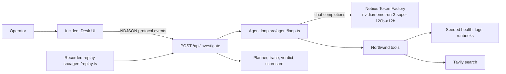

# Incident Desk

On-call investigation desk for a seeded checkout platform called Northwind. NVIDIA Nemotron, served by [Nebius Token Factory](https://docs.tokenfactory.nebius.com/api-reference/introduction), is the planner: it decides which service to open, which logs to search, when to read the runbook, and when to search the public web. Every plan step, tool call, and verdict stays on screen, and a scorecard checks the trace against the incident.

The same app still includes the original protocol console (streaming tokens, tool cards, reorder buffer, reconnect/RESUME) for any WebSocket agent backend.

**Replay is the default.** A recorded trace runs with no API key and is labeled `Replay` on screen. Nemotron is not called on that path. Live mode appears only after `NEBIUS_API_KEY` is set on the server.

## Architecture



Telemetry for service health, logs, and runbooks is the Northwind seed in `src/agent/incidents.ts`. It is not a live production account. `web_search` calls Tavily only when `TAVILY_API_KEY` is set. In replay, that tool returns a recorded example and says Tavily was not called.

## How Nemotron is called

The live path is an OpenAI-compatible chat completion. Nemotron is the only model in the loop: it plans, chooses tools, reads the tool results, and writes the verdict.

| Piece | Where |
| --- | --- |
| Model id `nvidia/nemotron-3-super-120b-a12b` and base URL `https://api.tokenfactory.nebius.com/v1` | `src/agent/constants.ts` |
| `POST {baseUrl}/chat/completions` with `Authorization: Bearer $NEBIUS_API_KEY` | `src/agent/nebius.ts` |
| Planner loop, tool results fed back as `role: "tool"` messages, reasoning stored on each step | `src/agent/loop.ts` |
| Tool schemas, including `web_search` | `src/agent/tools.ts` |
| Tavily `POST https://api.tavily.com/search` | `src/agent/tavily.ts` |
| HTTP entry the desk streams | `src/app/api/investigate/route.ts` |
| Key check used by the Live toggle | `src/app/api/health/route.ts` |

Overrides: `NEBIUS_MODEL`, `NEBIUS_BASE_URL`. A regional host such as `https://api.tokenfactory.us-central1.nebius.com/v1` can be set if you need one. The default is the global host from the Token Factory introduction.

If `NEBIUS_API_KEY` is missing and the client asks for live mode, the loop returns an error that names the variable, the model id, and the chat completions URL. It does not call the network and it does not fall through into the recorded trace. Replay is a separate, labeled mode.

Reasoning text from `message.reasoning_content` or `message.reasoning` is shown in the Planner card and stored as a `planner` context snapshot. The final answer is parsed for a JSON verdict (`severity`, `likely_cause`, `evidence_ids`, `recommended_action`, `confidence`, `summary`).

## Setup

Node.js 20+ and npm 10+.

```bash
npm run setup
cp .env.example .env.local   # optional; leave the keys blank for replay
npm run dev
```

Open http://localhost:3000. Leave the source on **Replay**, then open one of the three incidents: checkout latency, login 500s, or queue lag. The banner says Replay. The scorecard fills in when the trace finishes.

### Live Nemotron

```bash
export NEBIUS_API_KEY=...          # server only, never NEXT_PUBLIC_
export TAVILY_API_KEY=...          # optional, enables web_search
npm run dev
```

The Live Nemotron control enables when `/api/health` reports `nebiusConfigured: true`. Switch to it and run an incident. The banner says Live. Internal tools still read the Northwind seed.

Hackathon credits, if you still need a key, are described under [Participant credits](#participant-credits).

### One-command deploy

Docker Compose builds the Next.js app and the mock protocol server:

```bash
export NEBIUS_API_KEY=...     # optional
export TAVILY_API_KEY=...     # optional
npm run deploy                # docker compose up --build -d
```

The desk is at http://localhost:3000. `npm run stack` is the same compose file in the foreground.

Vercel can host the same Next.js app (`vercel.json` sets the investigate route to 60 seconds). A multi-step Nemotron run can exceed the hobby timeout, so Docker is the path that does not depend on that limit. Set `NEBIUS_API_KEY` and `TAVILY_API_KEY` in the host environment. They are read at request time by the route handlers.

The GitHub Pages build (`npm run build:pages`) is a static export. It stashes the API routes, ships the labeled in-browser replay, and does not call Nemotron.

## What changed since Aug 26, 2026

The repo before this work was a WebSocket debug console with canned agent scripts. This update turns it into an investigation product:

- Nemotron on Nebius Token Factory is the planner for a real incident loop, not a caption on the old mock.
- Four tools: service health, log search, runbook, and Tavily web search. Tool results go back into the next model call.
- A recorded replay for three seeded incidents, labeled in the UI, the context snapshot, and the tool payload. Replay never calls Nebius or Tavily.
- A scorecard that checks required tools, cause keywords, evidence ids, a recommended action, the service catalog, and the tool-call budget.
- Planner and verdict panels on top of the existing trace timeline and context diff.
- `POST /api/investigate` and `GET /api/health`, plus `npm run deploy` for Docker and a Vercel function timeout for the same route.
- Tests for the Nebius client and the agent loop using a mock `fetch`.

The protocol console, reorder buffer, and `agent-server` chaos checks are still there.

## Scorecard

`src/agent/eval.ts` scores a finished trace against the seeded incident. The checks are: required tools were called, the cause text contains a keyword from that incident, at least one seeded evidence id is cited, a recommended action is present, service arguments stay in the catalog, and the tool count is between 1 and 8. The panel shows pass or fail per check. It does not claim a production accuracy rate.

## Environment

| Variable | Required | Purpose |
| --- | --- | --- |
| `NEBIUS_API_KEY` | Live mode only | Bearer token for Token Factory. Server-side. |
| `NEBIUS_BASE_URL` | No | Defaults to `https://api.tokenfactory.nebius.com/v1` |
| `NEBIUS_MODEL` | No | Defaults to `nvidia/nemotron-3-super-120b-a12b` |
| `TAVILY_API_KEY` | No | Enables the live `web_search` tool |
| `NEXT_PUBLIC_WS_URL` | No | Protocol console socket. Default `ws://localhost:4747/ws` |

See [.env.example](.env.example).

## Scripts

| Command | Description |
| --- | --- |
| `npm run setup` | Install root + agent-server, build the mock backend |
| `npm run dev` | Next.js dev server, Incident Desk and API routes |
| `npm test` | Unit tests, including the Nebius client and agent loop |
| `npm run typecheck` | `tsc --noEmit` |
| `npm run deploy` | Docker Compose in the background |
| `npm run stack` | Docker Compose in the foreground |
| `npm run verify:server` | Protocol check against the mock server |
| `npm run verify:chaos` | Reordering, duplicates, disconnects |
| `npm run build:pages` | Static export with in-browser replay |

## Protocol console

The header link **Protocol console** opens the original WebSocket UI. Point it at `ws://localhost:4747/ws` (start `agent-server`) or `demo://agent` for the in-browser mock. Wire protocol: [docs/ADOPTING.md](docs/ADOPTING.md). Ordering and reconnect behavior are unchanged; see [DECISIONS.md](DECISIONS.md).

```bash
cd agent-server && npm start
# other terminal, from the repo root
npm run dev
```

Before Connect, if a previous client is holding the single mock socket:

```bash
bash scripts/ensure-clean-ws.sh
```

## Tests

```bash
npm test
npm run typecheck
```

`src/agent/nebius.test.ts` checks the missing-key error, the chat completions URL, the bearer header, tool-call parsing, and HTTP errors. `src/agent/loop.test.ts` runs the live loop against a mock `fetch`, checks that tool results are sent back, checks Tavily, and checks that every recorded replay passes the scorecard without network calls.

## Participant credits

The hackathon resources page lists two ways to get Token Factory credit:

- [$25 Token Factory credits](https://nebius.com/promo-code?utm_promo_event_code=2026-devpost-global-ai-hack&utm_promo_code_type=Token_Factory&utm_promo_activation_code=NEBIUS-DEVPOST-GLOBAL26) with activation code `NEBIUS-DEVPOST-GLOBAL26`. Token Factory's billing docs say a promo code can be applied without a bank card: balance → Top up → Apply promo code.
- Another $25, plus Tavily and Nebius Academy credits, by joining the [Nebius Builders Program](https://dev.nebius.com/builders).

This repo does not redeem those credits. Live mode was not executed against Token Factory in this change because no API key was available.

## Docs for the submission

- [docs/devpost.md](docs/devpost.md) — draft Devpost answers
- [docs/demo-script.md](docs/demo-script.md) — shot list for a demo under three minutes

## License

MIT — see [LICENSE](LICENSE).
