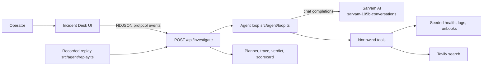

# Incident Desk

On-call investigation desk for a seeded checkout platform called Northwind. Sarvam AI (`sarvam-105b-conversations`) is the Paytm hackathon planner: it decides which service to open, which logs to search, when to read the runbook, and when to search the public web. Every plan step, tool call, and verdict stays on screen, and a scorecard checks the trace against the incident.

The same app still includes the original protocol console (streaming tokens, tool cards, reorder buffer, reconnect/RESUME) for any WebSocket agent backend.

**Replay is the default.** A recorded trace runs with no API key and is labeled `Replay` on screen. No model is called on that path. Live mode enables when the selected provider key is configured; credits are checked only when a live request is made.

## Architecture



Telemetry for service health, logs, and runbooks is the Northwind seed in `src/agent/incidents.ts`. It is not a live production account. `web_search` calls Tavily only when `TAVILY_API_KEY` is set. In replay, that tool returns a recorded example and says Tavily was not called.

## Sarvam integration

The server calls `https://api.sarvam.ai/v1/chat/completions` with the
`api-subscription-key` header. Sarvam plans, selects read-only tools, receives their
results, and writes the verdict. Keys never go into browser props or public variables.

- `src/agent/sarvam.ts`: Sarvam request and sanitized provider errors.
- `src/agent/provider.ts`: provider selection and public configuration status.
- `src/agent/loop.ts`: bounded tool loop and evidence-based verdict.
- `src/app/api/investigate/route.ts`: streamed investigation events.

Set `INCIDENT_PROVIDER=sarvam` to pin the provider. Otherwise a Sarvam key takes
priority, with the original Nebius integration retained for existing deployments
that only have `NEBIUS_API_KEY`. There is no provider fallback after an error.
`SARVAM_MODEL` optionally overrides the default model. A 402 is shown as a credit
error, never replaced by a replay. See [Paytm integration notes](docs/paytm-sarvam.md).

## Hackathon handoff

- [Public replay demo](https://mangeshraut712.github.io/agent-console/)
- [Paytm pitch PDF](docs/paytm-pitch.pdf) · [Editable PowerPoint](docs/paytm-pitch.pptx)
- [Three-minute demo script](docs/demo-script.md) · [Sarvam integration notes](docs/paytm-sarvam.md)

`npm run verify:desk` rehearses all three incidents on desktop and mobile using
installed Chrome, and never makes a live model request. Set APP_URL and
EVIDENCE_DIR to check another build. The public Pages demo is static replay;
server-side Sarvam calls require running the app locally or on a server.

## Setup

Node.js 20+ and npm 10+.

```bash
npm run setup
npm run dev
```

Open http://localhost:3000. Leave the source on **Replay**, then open one of the three incidents: checkout latency, login 500s, or queue lag. The banner says Replay. The scorecard fills in when the trace finishes.

### Live Sarvam

For a fresh clone, copy `.env.example` to `.env.local`, fill `SARVAM_API_KEY`, and
keep `INCIDENT_PROVIDER=sarvam`. Optional `TAVILY_API_KEY` enables public web search.
Never prefix secret keys with `NEXT_PUBLIC_`.

### One-command deploy

Docker Compose builds the Next.js app and the mock protocol server:

```bash
export SARVAM_API_KEY=...     # optional
export TAVILY_API_KEY=...     # optional
npm run deploy                # docker compose up --build -d
```

The desk is at http://localhost:3000. `npm run stack` is the same compose file in the foreground.

Vercel can host the same Next.js app (`vercel.json` sets the investigate route to 60 seconds). A multi-step model run can exceed the hobby timeout, so Docker is the path that does not depend on that limit. Set `INCIDENT_PROVIDER=sarvam`, `SARVAM_API_KEY`, and optionally `TAVILY_API_KEY` in the host environment. They are read at request time by the route handlers.

The GitHub Pages build (`npm run build:pages`) is a static export. It stashes the API routes, ships the labeled in-browser replay, and does not call any model.

## Investigation features

The repo before this work was a WebSocket debug console with canned agent scripts. This update turns it into an investigation product:

- Sarvam AI plans the live incident loop; Nebius remains an optional provider.
- Four tools: service health, log search, runbook, and Tavily web search. Tool results go back into the next model call.
- A recorded replay for three seeded incidents, labeled in the UI, the context snapshot, and the tool payload. Replay never calls a model or Tavily.
- A scorecard that checks required tools, cause keywords, evidence ids, a recommended action, the service catalog, and the tool-call budget.
- Planner and verdict panels on top of the existing trace timeline and context diff.
- `POST /api/investigate` and `GET /api/health`, plus `npm run deploy` for Docker and a Vercel function timeout for the same route.
- Tests for the Sarvam and Nebius clients and the agent loop using a mock `fetch`.

The protocol console, reorder buffer, and `agent-server` chaos checks are still there.

## Scorecard

`src/agent/eval.ts` scores a finished trace against the seeded incident. The checks are: required tools were called, the cause text contains a keyword from that incident, at least one seeded evidence id is cited, a recommended action is present, service arguments stay in the catalog, and the tool count is between 1 and 8. The panel shows pass or fail per check. It does not claim a production accuracy rate.

## Environment

| Variable | Required | Purpose |
| --- | --- | --- |
| `SARVAM_API_KEY` | Live Sarvam only | Server-side Sarvam subscription key. Never public. |
| `SARVAM_MODEL` | No | Defaults to `sarvam-105b-conversations` |
| `INCIDENT_PROVIDER` | No | `sarvam` or `nebius`; selects the live provider |
| `NEBIUS_API_KEY` | Live Nebius only | Bearer token for Token Factory. Server-side. |
| `NEBIUS_BASE_URL` | No | Defaults to `https://api.tokenfactory.nebius.com/v1` |
| `NEBIUS_MODEL` | No | Defaults to `nvidia/nemotron-3-super-120b-a12b` |
| `TAVILY_API_KEY` | No | Enables the live `web_search` tool |
| `NEXT_PUBLIC_WS_URL` | No | Protocol console socket. Default `ws://localhost:4747/ws` |

See [.env.example](.env.example).

## Scripts

| Command | Description |
| --- | --- |
| `npm run setup` | Install root + agent-server, build the mock backend |
| `npm run dev` | Next.js dev server, Incident Desk and API routes |
| `npm test` | Unit tests, including the Nebius client and agent loop |
| `npm run typecheck` | `tsc --noEmit` |
| `npm run deploy` | Docker Compose in the background |
| `npm run stack` | Docker Compose in the foreground |
| `npm run verify:server` | Protocol check against the mock server |
| `npm run verify:chaos` | Reordering, duplicates, disconnects |
| `npm run build:pages` | Static export with in-browser replay |

For protocol verification, use a normal mock server for `verify:server`. Stop it
and restart with `npm start --prefix agent-server -- --mode chaos` before running
`verify:chaos`. The verifier rejects mode mismatches and exits nonzero if any
scenario fails, even when subsequent scenarios pass.

## Protocol console

The header link **Protocol console** opens the original WebSocket UI. Point it at `ws://localhost:4747/ws` (start `agent-server`) or `demo://agent` for the in-browser mock. Wire protocol: [docs/ADOPTING.md](docs/ADOPTING.md). Ordering and reconnect behavior are unchanged; see [DECISIONS.md](DECISIONS.md).

```bash
cd agent-server && npm start
# other terminal, from the repo root
npm run dev
```

Before Connect, if a previous client is holding the single mock socket:

```bash
bash scripts/ensure-clean-ws.sh
```

## Tests

```bash
npm test
npm run typecheck
```

`src/agent/nebius.test.ts` checks the missing-key error, the chat completions URL, the bearer header, tool-call parsing, and HTTP errors. `src/agent/loop.test.ts` runs the live loop against a mock `fetch`, checks that tool results are sent back, checks Tavily, and checks that every recorded replay passes the scorecard without network calls.

## Participant credits

The hackathon resources page lists two ways to get Token Factory credit:

- [$25 Token Factory credits](https://nebius.com/promo-code?utm_promo_event_code=2026-devpost-global-ai-hack&utm_promo_code_type=Token_Factory&utm_promo_activation_code=NEBIUS-DEVPOST-GLOBAL26) with activation code `NEBIUS-DEVPOST-GLOBAL26`. Token Factory's billing docs say a promo code can be applied without a bank card: balance → Top up → Apply promo code.
- Another $25, plus Tavily and Nebius Academy credits, by joining the [Nebius Builders Program](https://dev.nebius.com/builders).

This repo does not redeem those credits. Live mode was not executed against Token Factory in this change because no API key was available.

## Docs for the submission

- [docs/devpost.md](docs/devpost.md) — draft Devpost answers
- [docs/demo-script.md](docs/demo-script.md) — shot list for a demo under three minutes

## License

MIT — see [LICENSE](LICENSE).
